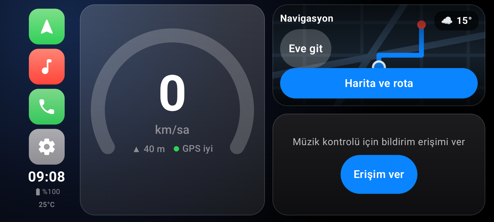
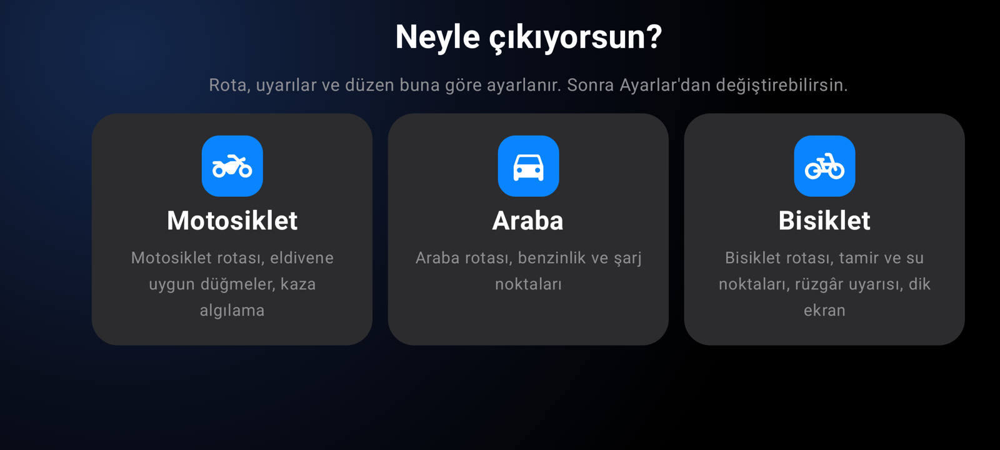
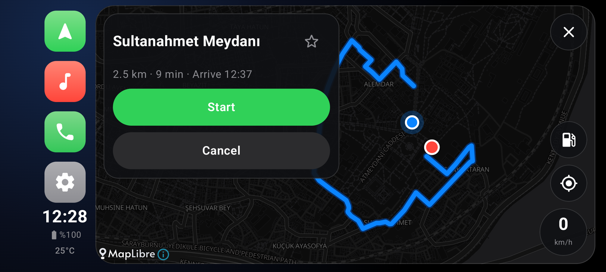
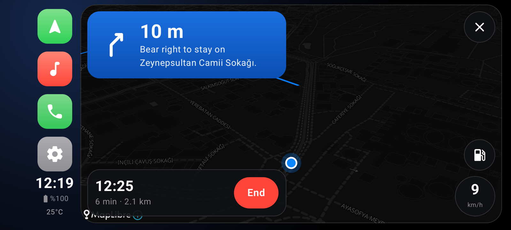
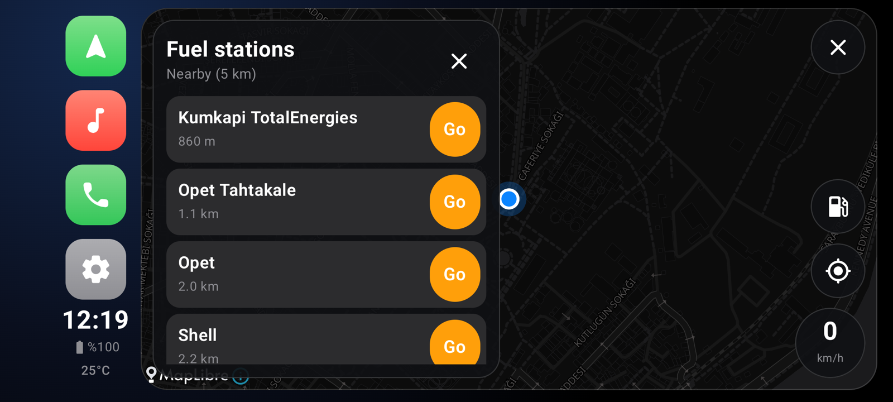
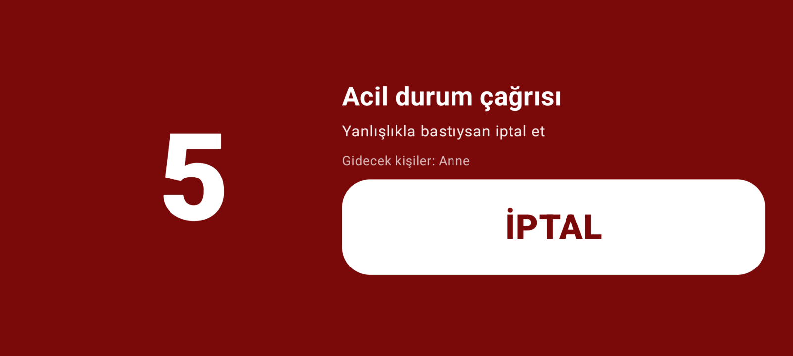
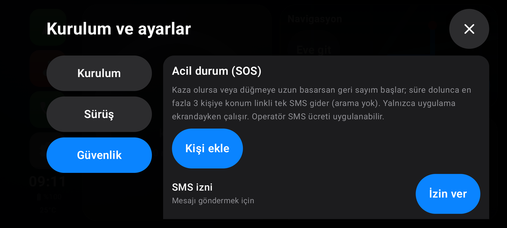
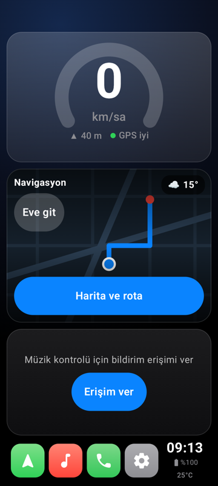

# MotoDash

[](https://github.com/yigitbuyukeren/carplay/actions/workflows/ci.yml)
[](LICENSE)

Motosiklet, araba ve bisiklet için CarPlay tarzı Android sürüş paneli (launcher). Telefonu gidona veya torpido üstüne takınca hız, harita, müzik ve telefon tek ekranda toplanır. İlk açılışta aracını seçersin (Ayarlar'dan değişir); rota, uyarılar ve düzen ona göre ayarlanır.



| İlk açılışta araç seçimi | Rota |
|---|---|
|  |  |

| Navigasyon | Benzinlikler |
|---|---|
|  |  |

| SOS geri sayımı | Güvenlik ayarları |
|---|---|
|  |  |

Bisiklet profilinde telefon dik de durabilir:



## Özellikler
**Araç profilleri**
- İlk açılışta Motosiklet / Araba / Bisiklet seçimi; Ayarlar > Kurulum'dan değişir, kendi ayarların korunur
- Rota araca göre: Valhalla `motorcycle`, `auto` veya `bicycle`; bisiklette yokuşsuz, düz zemin ve bisiklet tipi (yol / şehir / dağ)
- ⛽ düğmesi: motosiklette benzinlik, arabada benzinlik ve şarj istasyonu, bisiklette tamir noktası, bisiklet dükkânı ve içme suyu
- Kaza algılama eşikleri ve hız göstergesi ölçeği araca göre; bisiklette rüzgâr uyarısı ve dik ekran desteği (ana ekran, müzik, telefon, ayarlar dikey de çalışır)

**Gösterge ve sürüş**
- GPS hız göstergesi, saat, pil ve telefon sıcaklığı; gündüz/gece teması (ortam ışığına göre otomatik)
- Yolculuk kaydı: otomatik, geçmiş ekranı
- Hız kartında rakım ve GPS durumu; büyük, eldivenle basılan tuşlar
- Türkçe ve İngilizce arayüz

**Navigasyon**
- Gömülü harita ve sesli yönlendirme: MapLibre + OpenStreetMap (OpenFreeMap), Nominatim arama, Valhalla araç rotası, rota dışına çıkınca yeniden hesaplama
- Rota seçenekleri: otoyolsuz ve ücretsiz yol (bisiklette yokuşsuz ve düz zemin), seçim hatırlanır
- Kayıtlı yerler: Ev, İş ve favoriler; büyük karolarla tek dokunuşla rota, dashboard'da "Eve git"
- Park yeri: yolculuk bittiğinde aracın bırakıldığı yer otomatik kaydedilir ("Park yerine git"); eski bir gün ise tarihiyle görünür
- Duraklar (benzinlik, şarj, tamirci, su): yakınında veya rotanın üzerinde; navigasyon sırasında tek dokunuşla **ara durak** ekle, varınca "Yola devam"
- Yolun hız limiti ve aşınca sesli uyarı
- Sürerken arama kutusu kilitlenir (sürüş kuralı: hareket halindeyken yazı girişi yok); hedefi kayıtlı yerlerden veya haritaya uzun basarak seç
- Navigasyon sürerken ana ekranda canlı mini harita, sıradaki dönüş, kalan mesafe ve varış saati
- Arama kutusu için uygulamanın kendi Türkçe klavyesi

**Uygulamalar, widget ve ses**
- Uygulama rafı (dock'taki son karo): mesajlaşma, video veya istediğin uygulamayı sabitle, büyük karolarla tek dokunuşla başlat; ekleme ve sıralama sürerken kilitli; Ayarlar rafın sağ üstündeki dişli düğmesinden açılır
- Ana ekran kartları ayarlanır (Ayarlar > Sürüş): harita, müzik, uygulama sırası, sistem widget'ı veya boş; widget'ı kendi kurulum ekranıyla birlikte telefonundaki widget listesinden seçersin
- Rota kartında "Navigasyon uygulamasında aç" (Google Haritalar, Waze, Yandex Navi derin bağlantıları, yalnızca dururken); rota hâlâ MotoDash'te hesaplanır, canlı trafik isteyen bu uygulamalara geçer
- Sesle komut: mikrofon düğmesi (navigasyon kartı ve harita arama kutusu) ile "Kadıköy'e git", "eve git", "Ali'yi ara" (3 sn geri sayım, iptal edilebilir), "müziği aç/durdur", "sonraki şarkı", "sesi aç/kıs", "benzinlik", "navigasyonu bitir". Ses tanıma telefonun kendi servisiyle yapılır, telefona göre ses Google'a gidebilir; sürekli dinleme yok
- Mil ve mph ayarı (Ayarlar > Sürüş): hız, mesafe, hız limiti ve rota sesleri
- Mesaj uygulamalarını tek tek sessize alma (Ayarlar'da görülen uygulamalar için anahtar)

**Güvenlik**
- Hava durumu: sıcaklık, 1 saat içinde yağmur ve buzlanma uyarısı, bisiklette sert rüzgâr (şerit + sesli)
- Isınma koruması: telefon 42°C'yi aşınca ekran kısılır ve harita yavaşlar, araç durunca ekran kararır
- SOS (varsayılan kapalı): otomatik kaza algılama (sert darbe + hareketsizlik; iki tekerlekte telefonun yönü de değişmiş olmalı, çukur ve kırmızı ışık alarm vermez) veya uzun basmalı düğme; geri sayımdan sonra en fazla 3 kişiye konum linkli **tek** SMS, arama yok

**Telefon ve medya**
- Uygulama içi telefon: son aramalar, tüm rehber ve tuş takımı (eşleşen kişi önerisi, yapıştır, `0` uzun basınca `+`); sürerken tuş takımı kilitli
- MotoDash'i varsayılan telefon uygulaması yaparsan arama ekranı da uygulamanın içinde: sessiz, ses yolu (telefon, hoparlör, Bluetooth), ses seviyesi, görüşme tuş takımı
- Müzik: yalnızca müzik uygulamalarının oturumu, ilerleme çubuğu, kapağı kaydırarak şarkı geçme, ses tuşları; hiçbir şey çalmıyorken Oynat son müziği başlatır (bildirim erişimi gerekir)
- Mesajları sesli okuma (yalnızca MotoDash ekrandayken)
- Diğer uygulamaların üstünde hız/saat şeridi; ana ekran (HOME) launcher olarak ayarlanabilir

## Derleme
```bash
export JAVA_HOME=/opt/homebrew/opt/openjdk@17
./gradlew testDebugUnitTest assembleDebug
adb install -r app/build/outputs/apk/debug/app-debug.apk
```
`local.properties` içinde `sdk.dir` ayarlı olmalı (dosya git'e girmez).

Sürüm APK'sı (R8 ile küçültülmüş, ~24 MB): kök dizine `keystore.properties` koy (`storeFile`, `storePassword`, `keyAlias`, `keyPassword`; dosya git'e girmez) ve `./gradlew assembleRelease` çalıştır. Dosya yoksa APK imzasız çıkar.

## Gizlilik ve izinler
Hesap ve sunucu yok; veriler telefonda kalır. Dışarı giden tek şey, aşağıdaki genel servislere giden sorgulardır: arama metni (Nominatim, yalnızca Ara'ya basınca), rota uç noktaları ve hız limiti için son konum noktaları (Valhalla), yaklaşık konum (hava durumu için 1 km hassasiyetle, Open-Meteo), çevre veya rota boyunca benzinlik sorgusu (Nominatim / Overpass).

SOS yalnızca sen açarsan çalışır ve `SEND_SMS` izni ister; kişiler telefonun kişi seçicisinden eklenir (rehber izni gerekmez). Sesle komut için mikrofon izni ilk kullanımda ekrandaki düğmeyle istenir; ses tanıma Android'in kendi tanıyıcısıyla yapılır. Kaza algılama yalnızca uygulama ekrandayken çalışır; Android arka plandaki sensörleri kısıtlar. Operatörün SMS ücreti uygulanabilir. Bu özellik bir güvenlik garantisi değildir.

## Güvenlik notu
Bu uygulama sürüş sırasında dikkat dağıtabilir. Telefonu sabitle, ayarları park halindeyken yap ve trafik kurallarına uy. Yazılım garantisiz sunulur (Apache 2.0).

## Kullanılan servisler ve atıflar
- Harita verisi © [OpenStreetMap](https://www.openstreetmap.org/copyright) katkıda bulunanlar (ODbL)
- Harita karoları: [OpenFreeMap](https://openfreemap.org); harita motoru: [MapLibre Native](https://maplibre.org)
- Adres arama: [Nominatim](https://nominatim.org) (genel sunucu; kullanım politikasına uygun olarak yalnızca Ara'ya basınca sorgular)
- Rota: [Valhalla](https://github.com/valhalla/valhalla) genel sunucusu (`valhalla1.openstreetmap.de`)
- Hava durumu: [Open-Meteo](https://open-meteo.com) (ücretsiz, anahtarsız; ticari olmayan kullanım)
- Benzinlikler: [Overpass API](https://overpass-api.de) genel sunucuları (birkaçına birden sorulur) ve Nominatim

Bunlar ücretsiz, garantisiz genel servislerdir. Yoğun veya ticari kullanım için kendi sunucunu kur.

## Katkı
Issue ve PR'lar açık. Başlamak için [CONTRIBUTING.md](CONTRIBUTING.md) dosyasına ve [docs/STATUS.md](docs/STATUS.md) içindeki "Sıradaki işler" listesine bak. Fikirler: yeni dil çevirileri, çevrimdışı harita ve rota (büyük iş), tablet ve katlanabilir ekran düzenleri.

## Lisans
[Apache 2.0](LICENSE)
